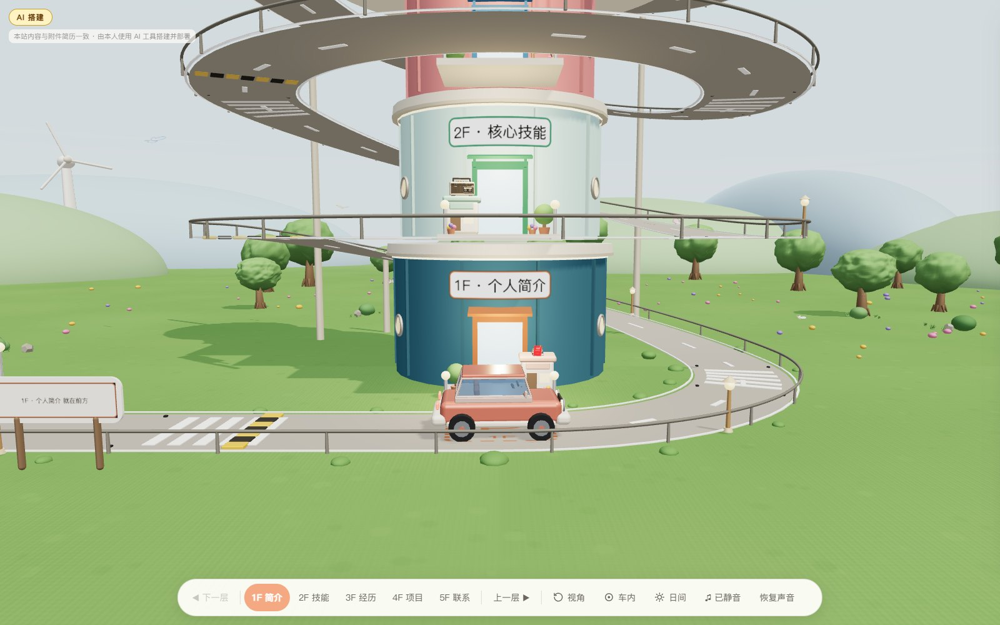
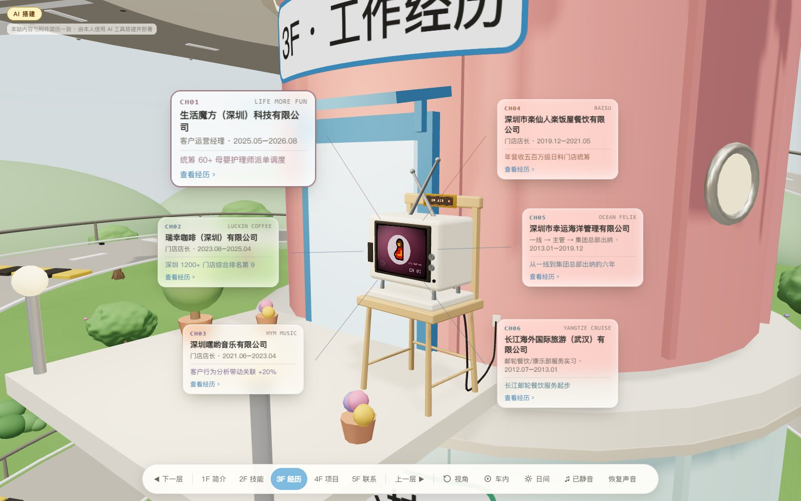
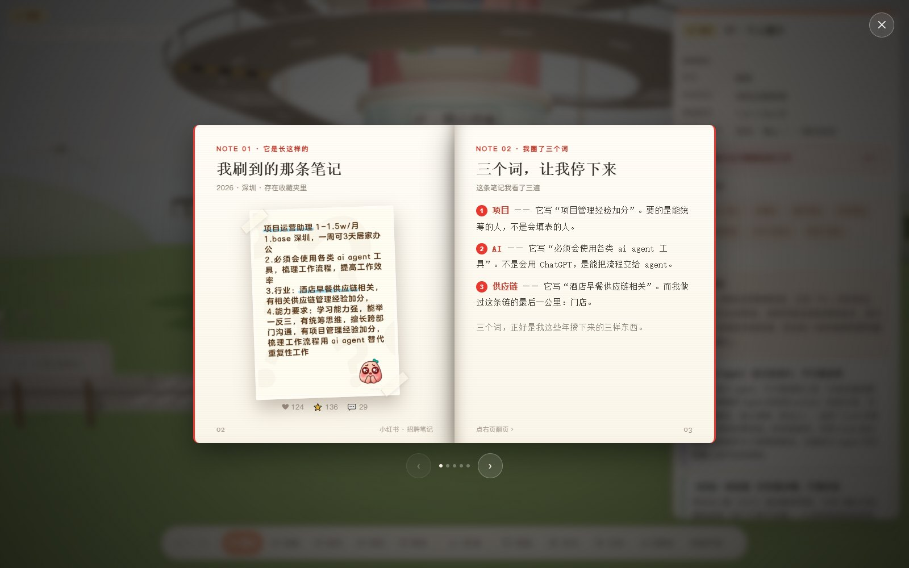
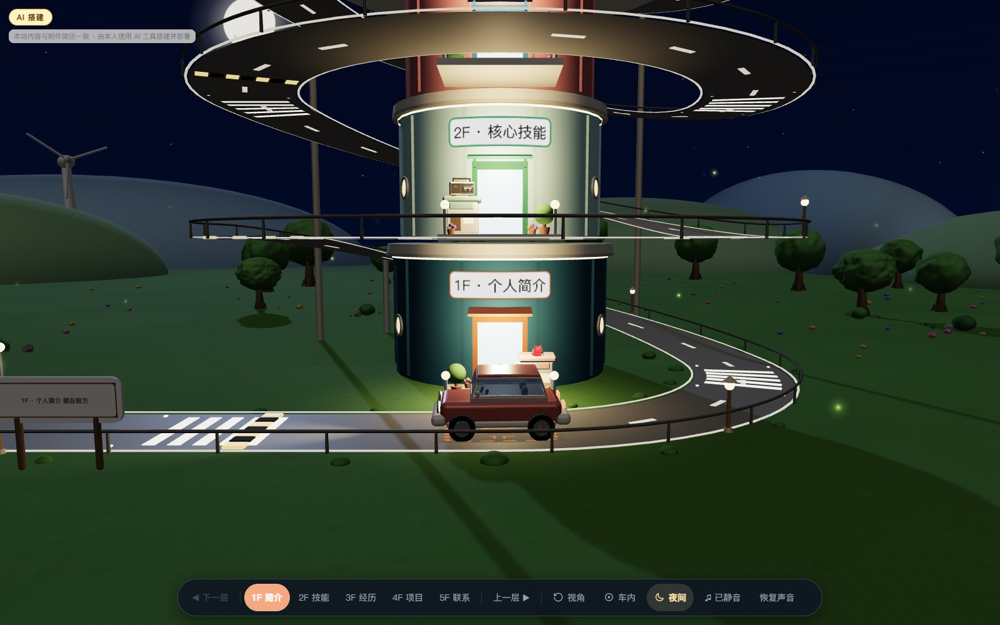
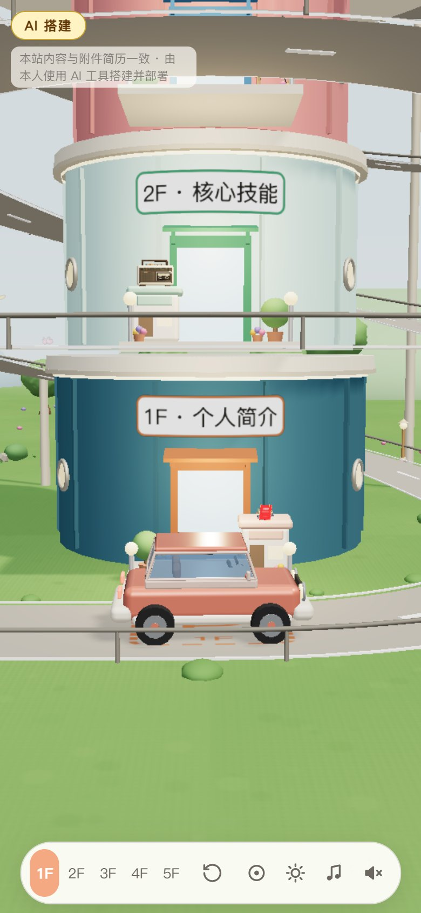
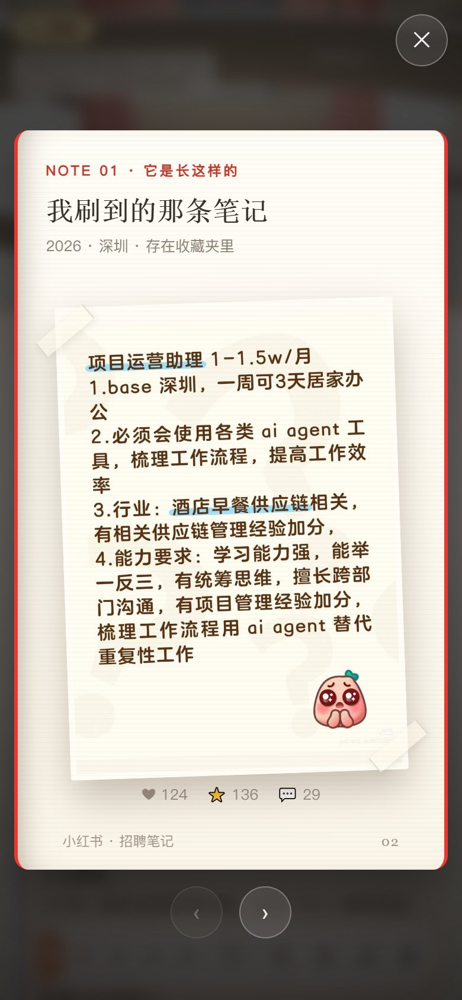

# 职业大楼 · 3D 个人网站

一座五层卡通职业大楼，外侧是连续盘旋车道，一辆卡通小车担任导览员。
点击楼层或项目展板，小车会沿真实车道开过去，相机平滑跟随；内容面板为 HTML 渲染。

> 本站为**模拟简历演示案例**：所有内容为模拟数据，仅供展示。
> 本仓库只放构建后的**单文件成品**（`index.html`，音频已内嵌，无外部依赖）；源码暂不公开。

## 在线访问

**https://<你的用户名>.github.io/<仓库名>/**

（把上面这行换成实际地址；部署方式见下）

## 截图

| | |
| :---: | :---: |
|  |  |
|  |  |
|  |  |

## 使用说明

- **在线**：直接打开上面的链接。
- **离线**：下载 `index.html` 后双击即可 —— 自带全部内容，无需安装、无需联网、可直接发给别人。
- 若打开后页面空白并提示 WebGL 不可用，请换最新版 Chrome / Edge，并确认浏览器已开启「硬件加速」。
- 桌面端体验最佳；手机端也可用：
  - 手机点开 3F 老电视后，屏幕**上方三张、下方三张**是六个频道卡片；
  - 屏幕下方会出现两个**大旋钮**（CH− / CH+）用来换台，不用去点电视上那两个小旋钮；
  - 点任意卡片 = 打开对应的工作经历。

## 部署（GitHub Pages）

1. 仓库 Settings → **Pages** → Source 选 `Deploy from a branch`；
2. 分支选 `main`、目录选 `/ (root)`，保存；
3. 等 1 分钟左右，`https://<用户名>.github.io/<仓库名>/` 就能访问。
